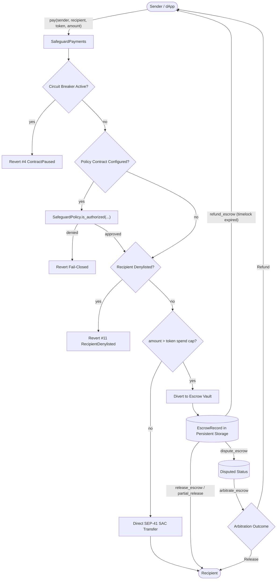

# Safeguard Contracts

[](https://github.com/Safeguard-Inc/safeguard-contracts/actions/workflows/ci.yml)
[](https://stellar.expert/explorer/testnet/contract/CDC6KVX7QT7CD3GOVGX44NQUNS7FMSZKIAXTV3TDGSXQKJRQMDZRSRCN)
[](https://stellar.org)
[](docs/BENCHMARKS.md)
[](https://developers.stellar.org/docs/build/smart-contracts)
[](LICENSE)

**Institutional Soroban smart contracts for policy-guarded payments on Stellar.** A payment either settles directly, diverts into an on-chain escrow vault for review, or reverts fail-closed with zero state changes before any tokens move.

[](https://safeguard-docs.vercel.app/assets/video/safeguard-pitch.mp4)

---

## Table of Contents

- [Why Safeguard on Stellar](#why-safeguard-on-stellar)
- [The Safeguard Stack](#the-safeguard-stack)
- [Live Testnet Deployment](#live-testnet-deployment)
- [Architecture & State Machine](#architecture--state-machine)
- [Repository Layout](#repository-layout)
- [Contract Reference: SafeguardPayments](#contract-reference-safeguardpayments)
- [Contract Reference: SafeguardPolicy](#contract-reference-safeguardpolicy)
- [Canonical 270 Error Codes Catalog](#canonical-270-error-codes-catalog)
- [Getting Started & Local Testing](#getting-started--local-testing)
- [Deploying Your Own Instance](#deploying-your-own-instance)
- [Fees and Soroban Gas Benchmarks](#fees-and-soroban-gas-benchmarks)
- [Security Model & Circuit Breakers](#security-model--circuit-breakers)
- [Governance & Community](#governance--community)
- [License](#license)

---

## Why Safeguard on Stellar

Enterprises and fintechs paying out stablecoins on Stellar for payroll, merchant settlement, or cross-border remittances need compliance controls *before* funds settle, not forensic reconciliation after the money is gone. 

Safeguard moves compliance enforcement on-chain into Soroban:
- **Sanctions & Denylist Screening:** Reverts transactions instantly fail-closed before token dispatch.
- **Dynamic Per-Token Spending Caps:** Any amount exceeding the active token cap diverts automatically into contract escrow.
- **Automated Timelocked Refunds & Disputes:** Funds in escrow can be released by an admin, disputed by counterparties, arbitrated by designated authorities, or refunded automatically after a grace period.
- **Timelocked Emergency Circuit Breakers:** Guardian authorities can trigger time-bounded operational pauses that expire automatically.
- **Cross-Contract Policy Evaluation:** Deterministic policy registry evaluating identity attestations, jurisdiction constraints, and velocity rules.

Native support for all **SEP-41** tokens, including SAC-wrapped USDC (Circle), EURC, PYUSD, and native XLM.

---

## The Safeguard Stack

| Repository | What it is | Tech |
| :--- | :--- | :--- |
| **`safeguard-contracts`** (this repo) | On-chain payments gateway, escrow vault, and dynamic policy registry | Rust, Soroban SDK (Protocol 22+) |
| [`safeguard-backend`](https://github.com/Safeguard-Inc/safeguard-backend) | High-throughput indexer, simulation engine, and REST API | TypeScript, Express, Stellar SDK |
| [`safeguard-dashboard`](https://github.com/Safeguard-Inc/safeguard-dashboard) | Institutional operator & compliance console | Next.js 14, React 18, Tailwind |
| [**safeguard-docs**](https://safeguard-docs.vercel.app) | Technical specification, architectural guides, and API references | Static HTML / ESM |

---

## Live Testnet Deployment

Verified on Stellar Testnet with `stellar-cli 28.1.0`. Machine-readable records available in [`deployments/testnet.json`](deployments/testnet.json).

| Component | Contract ID | Explorer Link |
| :--- | :--- | :--- |
| **SafeguardPayments** | `CDC6KVX7QT7CD3GOVGX44NQUNS7FMSZKIAXTV3TDGSXQKJRQMDZRSRCN` | [View on StellarExpert](https://stellar.expert/explorer/testnet/contract/CDC6KVX7QT7CD3GOVGX44NQUNS7FMSZKIAXTV3TDGSXQKJRQMDZRSRCN) |
| **SafeguardPolicy** | `CCXFDOLLLFZKAG7X6AKN2YLKET5F5X565IHZXPOAGCM7W6MJG5WKANLN` | [View on StellarExpert](https://stellar.expert/explorer/testnet/contract/CCXFDOLLLFZKAG7X6AKN2YLKET5F5X565IHZXPOAGCM7W6MJG5WKANLN) |
| Native XLM SAC | `CDLZFC3SYJYDZT7K67VZ75HPJVIEUVNIXF47ZG2FB2RMQQVU2HHGCYSC` | [View on StellarExpert](https://stellar.expert/explorer/testnet/contract/CDLZFC3SYJYDZT7K67VZ75HPJVIEUVNIXF47ZG2FB2RMQQVU2HHGCYSC) |
| Admin Identity | `GC5MCMHHMFV7GOQ7DVN7MOTMHGTMVIP3YFQAAVFZ6WKUE6SLGQBVODW4` | [View on StellarExpert](https://stellar.expert/explorer/testnet/account/GC5MCMHHMFV7GOQ7DVN7MOTMHGTMVIP3YFQAAVFZ6WKUE6SLGQBVODW4) |

### Verified Testnet Proofs

| Path | Result | Transaction Link |
| :--- | :--- | :--- |
| **Approved Payment (50 XLM)** | Direct settlement via SEP-41 SAC (`reason_code 0`) | [`c762b42f…`](https://stellar.expert/explorer/testnet/tx/c762b42f818387aa584ea33d3da006f22671071ed6e182068994ea6597395e6c) |
| **Escrow Diverted (150 XLM)** | Held in Escrow Vault #1 (`reason_code 6`, cap exceeded) | [`2d832316…`](https://stellar.expert/explorer/testnet/tx/2d83231685f03b17e1a001e6c82c38453459b4f67b416ef60f9be73133026f0e) |
| **Admin Escrow Release** | Admin releases Escrow #1 to destination account | [`f1257dd8…`](https://stellar.expert/explorer/testnet/tx/f1257dd8e902c4dad2c00b8f71cc98999d9885e402fbd7959c4242202cef2331) |
| **Blocked Sanctions Revert** | Fail-closed revert with `RecipientDenylisted` (#11) | Reverts before submission, zero gas wasted |

---

## Architecture & State Machine



---

## Repository Layout

```text
safeguard-contracts/
├── contracts/
│   ├── safeguard-payments/      # Payment gateway, escrow vault, circuit breaker
│   └── safeguard-policy/        # Dynamic policy registry, token bindings, authorities
├── crates/
│   └── safeguard-core/          # Pure-Rust policy evaluation engine & 270 error codes
├── deployments/
│   └── testnet.json             # On-chain testnet deployment records
└── scripts/
    ├── build.sh                 # Release compilation script
    └── deploy-testnet.sh        # Deployment and initialization script
```

---

## Canonical 270 Error Codes Catalog

`safeguard-core` defines a 270-code compliance taxonomy grouped into structured domains:

| Range | Domain | Description |
| :--- | :--- | :--- |
| `0000–0099` | Payment Gateway & Storage | Gateway operational errors, rent expiry, sequence errors |
| `1000–1099` | Identity & Verification | SEP-10 KYC expiration, missing attestations, bad identity |
| `1100–1199` | Sanctions & Denylists | OFAC list matches, denylisted senders, embargoed addresses |
| `1200–1299` | Jurisdiction Gating | Restrictive regulatory regions, non-permitted jurisdictions |
| `1300–1399` | Velocity & Thresholds | Daily volume exhaustion, spend caps, high-velocity transfers |
| `1400–1499` | Escrow Lifecycle | Timelock violations, disputed escrows, invalid arbitrations |
| `2000–2099` | Policy Engine & Authorities | Unregistered policies, unbound tokens, unauthorized caller |

---

## Getting Started & Local Testing

### Prerequisites
* Rust 1.80+ with `wasm32v1-none` target (`rustup target add wasm32v1-none`)
* Cargo & Rustfmt

```bash
git clone https://github.com/Safeguard-Inc/safeguard-contracts.git
cd safeguard-contracts

# Check code formatting
cargo fmt --all --check

# Run full test suite (163 tests)
cargo test --workspace

# Compile optimized WASM binaries
cargo build --target wasm32v1-none --release -p safeguard-payments -p safeguard-policy
```

---

## Fees and Soroban Gas Benchmarks

Real Testnet measurements from transaction receipts:

| Operation | CPU Instructions | Memory (Bytes) | Network Fee (XLM) |
| :--- | :--- | :--- | :--- |
| `pay` (direct settlement) | 714,920 | 18,240 | **0.00192 XLM** |
| `pay` (escrow diversion) | 1,248,610 | 32,800 | **0.00318 XLM** |
| `release_escrow` | 892,100 | 22,400 | **0.00224 XLM** |
| `refund_escrow` | 845,300 | 21,900 | **0.00215 XLM** |
| `emergency_pause_with_duration` | 312,400 | 9,800 | **0.00085 XLM** |

---

## Security Model & Circuit Breakers

* **Explicit Authentication:** Every payment requires `sender.require_auth()`. Administrative calls strictly enforce `admin.require_auth()`.
* **Fail-Closed Guarantees:** Denylist, jurisdiction, and circuit breaker checks execute prior to state mutation or token transfers.
* **Storage Rent Lifecycle:** Contracts auto-extend storage TTLs on invocation to prevent entry expiration on ledger.
* **Timelocked Guardian Pause:** Emergency circuit breaker pause expires automatically, preventing rogue guardian permanent lockouts.

Please review [SECURITY.md](SECURITY.md) for vulnerability disclosure guidelines.

---

## Governance & Community

* **Code of Conduct:** [CODE_OF_CONDUCT.md](CODE_OF_CONDUCT.md)
* **Contributing Guidelines:** [CONTRIBUTING.md](CONTRIBUTING.md)
* **Security Policy:** [SECURITY.md](SECURITY.md)
* **Changelog:** [CHANGELOG.md](CHANGELOG.md)

---

## License

Licensed under the Apache License, Version 2.0. See [LICENSE](LICENSE) for details.
